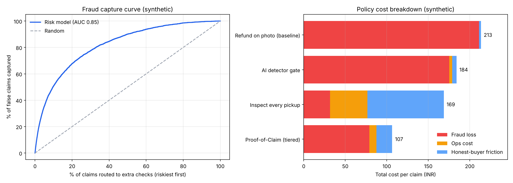

# Proof-of-Claim: stopping AI-faked refund photos without slowing honest shoppers

A product project by **Srinjoyee Chakravarty** (BITS Pilani): a working risk-tiered refund verification app, plus the product work behind it. It covers the problem and market evidence, a competitor map, market sizing, RICE prioritisation, a PRD, a claim-risk model with a policy simulation in Python, a clickable return-flow prototype, an A/B test plan and a build roadmap.

> **Status (Oct 2026):** the working app, risk model, simulation, PRD and research tooling are built. User research and usability testing are in progress (see [research/research_kit.md](research/research_kit.md)); findings will be added in `research/findings.md` as they come in.
>
> Personal, self-initiated project. All model results come from a **synthetic** dataset with assumptions stated in the code. It is not affiliated with, or based on internal data from, any company.

**Working app:** `https://<your-github-username>.github.io/proof-of-claim/app/` - scores a claim in the browser, sets the proof requirement, captures a live photo with a random prompt, fingerprints it (SHA-256 + perceptual hash), flags near-duplicates of earlier claims and outputs a claim record.

**Flow mock-up:** `https://<your-github-username>.github.io/proof-of-claim/prototype/` (turn on GitHub Pages for this repo)

## The problem

Refunds for "damaged" or "wrong item" claims usually rest on a single shopper photo, and generative AI has made that photo cheap to fake. In early 2026, Zomato's CEO said publicly that some customers doctor food photos with AI to claim refunds, a Mumbai bakery exposed an AI-generated "smashed cake" used for a Rs 1,820 refund, US brands reported AI-faked damage photos, and Taobao/Tmall launched an AI-image detector for refund claims. Today's fixes trade one harm for another. Detectors miss good fakes and flag real photos, so honest shoppers get denied. Inspecting every return protects money but makes everyone wait.

**Question:** how can a marketplace make faked claims costly to attempt while keeping refunds instant for most honest shoppers?

## The idea

**Verify at capture, not detect after.** A claim risk score decides how much proof each claim needs. Low-risk claims (about 55%) get an instant refund on any photo. Riskier claims must use **live in-app capture with a random prompt** (for example, "tilt the box to show the label" or "hold the item next to this order QR"), so an AI-edited gallery image cannot be submitted at all. The riskiest claims also get a doorstep inspection, and the top 3% go to specialist review with a one-tap appeal. The AI detector is one signal in the score, never the judge.

## Why it matters

A top-down estimate for one large Indian marketplace puts fraud exposure on damage and wrong-item claims at about **Rs 288 Cr a year** in the base case (range Rs 75-700 Cr). A 63% reduction is worth about **Rs 180 Cr a year** against about Rs 27 Cr of added ops cost. Every input is an assumption and is listed in [docs/market_sizing.md](docs/market_sizing.md).

## What's in the repo

| Piece | Where |
|---|---|
| Existing solutions, competitors and frameworks, with the gap this fills | [docs/competitive_landscape.md](docs/competitive_landscape.md) |
| Market sizing (low / base / high) | [docs/market_sizing.md](docs/market_sizing.md) |
| Options compared with RICE plus a guardrail gate, rejected ideas | [docs/prioritisation.md](docs/prioritisation.md) |
| PRD: users, insight, four-band solution, requirements with acceptance criteria, metrics, risks, rollout | [docs/PRD.md](docs/PRD.md) |
| Risk model + policy simulation (150,000 synthetic claims, gradient boosting) | [analysis/simulate.py](analysis/simulate.py) |
| **Working app**: in-browser claim scoring, live camera capture with random prompts and claim codes, SHA-256 + dHash fingerprinting, near-duplicate detection, claim records | [app/index.html](app/index.html) |
| Scorer export (trains the in-browser model) | [analysis/export_scorer.py](analysis/export_scorer.py) |
| Complaint-mining pipeline with hand-label agreement (Cohen's kappa) | [research/mine_complaints.py](research/mine_complaints.py) |
| Interview guides, usability test and detector test protocols | [research/research_kit.md](research/research_kit.md) |
| Clickable mock-up of the return flow for each band | [prototype/index.html](prototype/index.html) |
| A/B test plan with guardrails and sample size | [docs/experiment_plan.md](docs/experiment_plan.md) |
| Plan for turning this into a working system | [docs/build_roadmap.md](docs/build_roadmap.md) |

## Results (synthetic)



| Policy | Fraud loss / claim | Share of fraud exposure paid out | Ops cost / claim | Honest wait (days) | Honest instant refunds | Honest wrongly denied / 10k | Total cost / claim |
|---|---|---|---|---|---|---|---|
| Refund on photo (baseline) | Rs 211 | 100% | Rs 0 | 0.1 | 100% | 0 | Rs 213 |
| AI-detector gate | Rs 175 | 83% | Rs 4 | 0.2 | 96% | 12.5 | Rs 184 |
| Inspect every pickup | Rs 32 | 15% | Rs 45 | 4.0 | 0% | 0 | Rs 169 |
| **Proof-of-Claim (tiered)** | **Rs 79** | **37%** | Rs 9 | **0.8** | **59%** | 3.1 | **Rs 107** |

Takeaways:

1. **A detector alone barely helps.** It recovered only 17% of fraud losses and wrongly denied about 12 honest shoppers per 10,000, because it only sees AI-edited photos and still makes mistakes on real ones. As a single signal its AUC was 0.62.
2. **Combining signals works much better.** The risk model reached a holdout AUC of 0.85. The riskiest 15% of claims held 60% of fraud, and the riskiest 45% held 87%.
3. **The tiered policy halves total cost.** It cut fraud loss by 63% and total cost per claim by 50% against baseline. Honest shoppers waited 0.8 days on average, against 4 days if every pickup is inspected.
4. **The trade-off is honest instant refunds.** They fall from 100% to 59%, which is the guardrail to watch in the A/B test. The band cut-offs are the lever for tuning it.
5. **It does not depend on live capture working perfectly.** Even if live capture deterred no AI-photo fraud at all, the tiered policy still cost Rs 116 per claim against Rs 213 at baseline (`analysis/output/sensitivity_live_capture.csv`).

## Run it

```bash
pip install -r requirements.txt
python analysis/simulate.py
python analysis/export_scorer.py   # rebuilds app/model.js
```

To try the app locally: `python -m http.server` in the repo folder, then open `http://localhost:8000/app/`. The camera needs https or localhost.

All assumptions (fraud rate, AI-photo share, detector accuracy, costs, deterrence) sit at the top of the script.

## Sources (public reporting used for problem framing)

- Curly Tales and Storyboard18 (Jan 2026): Zomato CEO on AI-doctored food photos; the Mumbai bakery "Aappy Birthda" case.
- Modern Retail: US brands catching AI-faked damage photos in return claims.
- OECD AI Incidents Monitor: Taobao/Tmall AI-image detection for refund claims (Jan 2026).
- Practical Ecommerce: US retail returns of about $849.9B in 2025, about 9% fraudulent; no reliable data yet on the AI-assisted share.
- C2PA / Content Credentials specification; Google Pixel 10 signing camera photos.
- Retail Gazette (Jun 2026), citing Forter data on AI-generated damage claims as the fastest-growing form of return abuse.
- Switch Labs, summary of AIGIBench, arXiv 2602.07814 and a May 2026 NewsGuard audit on detector accuracy.

## Limitations

The data is synthetic, so the value is the policy comparison and reasoning, not the absolute numbers. Fraud labels are hard to observe in reality; the experiment plan uses proxies. Fairness to new users is handled in the PRD but not measured in the simulation.
